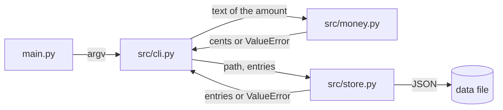
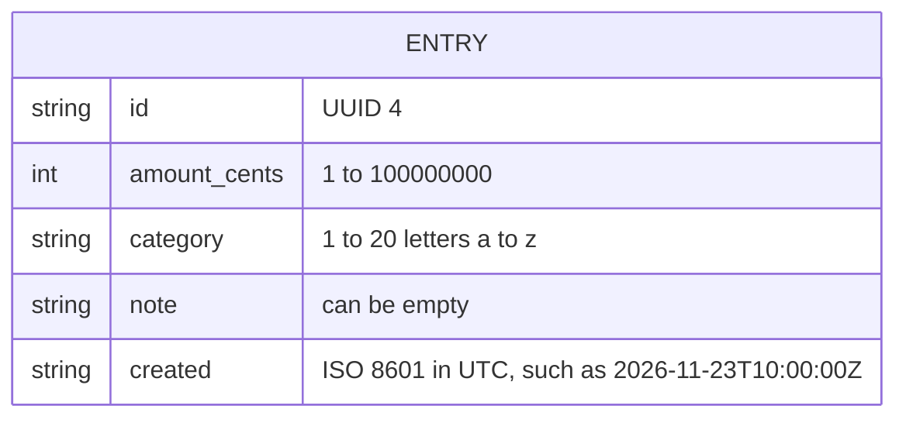

# Design — ledger

How to build what `spec.md` says. If this file and the spec disagree, the spec wins.

## 1. Decisions

One current decision per topic. Status: `Decided` means the user chose or confirmed it. `Proposed`
means the AI derived it and the user has not confirmed it. `Superseded` means a newer decision
replaced it: keep its row, and name the replacement in Why. Never reuse or renumber an ID. Why
names the driver (a requirement ID or a constraint) and the alternative that the decision rejects.

| ID | Status | Decision | Why |
| --- | --- | --- | --- |
| DEC-001 | Decided | Python 3.12, standard library only: `json`, `uuid`, `datetime`, `re` | A small tool needs no dependency; SQLite was rejected as more than one file needs |
| DEC-002 | Decided | Amounts are whole cents (`int`) inside the program, and text with two decimals outside (LEDG-002, LEDG-004) | A `float` cannot hold 0.10 exactly |
| DEC-003 | Decided | `src/store.py` writes the data file to a temporary file in the same folder, then replaces the data file with it (LEDG-006, LEDG-007) | A write that stops in the middle leaves the old file readable; a write in place was rejected |

## 2. Architecture

### 2.1 Components

- `main.py`: the entry point. It calls `src.cli.main()` and exits with its return value.
- `src/cli.py`: reads the arguments and `LEDGER_DATA`, checks the category, calls the other
  modules, prints the result or the error, and returns the exit code.
- `src/money.py`: turns the text of an amount into cents, and cents into text. Pure.
- `src/store.py`: reads and writes the data file. The only module that touches it.

### 2.2 Directory structure

| Path | Holds |
| --- | --- |
| `main.py` | The entry point. |
| `src/` | `money.py`, `store.py` and `cli.py`. |
| `data/` | The default data file, `ledger.json` (never committed). |
| `tests/` | `unit/` and `e2e/` tests. |

### 2.3 Settings

| Setting | Default | Meaning |
| --- | --- | --- |
| `LEDGER_DATA` (environment variable) | `data/ledger.json` | The path of the data file (LEDG-006) |

### 2.4 Module boundaries

| Module | May import |
| --- | --- |
| `src/money.py` | none |
| `src/store.py` | none |
| `src/cli.py` | `src/money.py`, `src/store.py` |

## 3. Data model

- Entry: owned by `src/store.py`, stored in the data file.
- The data file is a JSON object with one key, `entries`: a list of objects, each with exactly the
  five keys of the entry. Any other content is not a valid ledger (LEDG-007).

## 4. Interfaces

Name every interface a test needs: entry points, inputs and outputs, stored records, and public
functions. For a stored record, link to its entity in "3. Data model" and do not copy its
attributes. The tests are written from the spec and this file, without the code.

- `src.money.parse_amount(text: str) -> int`: returns the amount in cents. Raises
  `ValueError("the amount must be a number from 0.01 to 1000000.00 with at most two decimals")`.
- `src.money.format_amount(cents: int) -> str`: returns the amount with two decimals, such as
  `12.50`.
- `src.store.Entry`: a frozen dataclass with the five attributes of the entry (3. Data model), in
  that order.
- `src.store.load(path: Path) -> list[Entry]`: the entries of the data file, in the order of entry.
  A missing file gives `[]`. Raises `ValueError("the data file is not a valid ledger")`.
- `src.store.save(path: Path, entries: list[Entry]) -> None`: writes the entries, and makes the
  folder of the file when it does not exist.
- `src.cli.main(argv: list[str] | None = None) -> int`: `argv` without the program name (default:
  `sys.argv[1:]`). Prints the result or the error and returns the exit code (0, 2 or 3).
- Command line: `python main.py add AMOUNT CATEGORY [--note TEXT]`, `python main.py total
  [--category CATEGORY]` and `python main.py list`, run from the project root, with the data file
  of `LEDGER_DATA`.

## 5. Test design

| Requirement | Level | Test tool | Real local part or fake |
| --- | --- | --- | --- |
| LEDG-002 | unit | pytest, through `parse_amount` | None needed |
| LEDG-006, LEDG-007 | unit | pytest, through `load` and `save` | A data file in a temporary folder |
| LEDG-001, LEDG-002, LEDG-003, LEDG-004, LEDG-005, LEDG-006, LEDG-007 | e2e | pytest, runs `main.py` as a process with `sys.executable` and `subprocess.run`, with `LEDGER_DATA` set to a file in a temporary folder | The real program and a real data file |

## 6. Open design questions

The design is approved when no decision is `Proposed` and this table is empty.

| ID | Question | Who decides | Blocks what |
| --- | --- | --- | --- |
