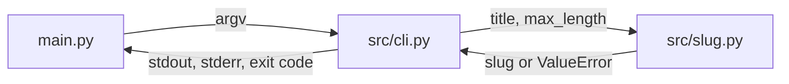

# Design — slugger

How to build what `spec.md` says. If this file and the spec disagree, the spec wins.

## 1. Decisions

One current decision per topic. Status: `Decided` means the user chose or confirmed it. `Proposed`
means the AI derived it and the user has not confirmed it. `Superseded` means a newer decision
replaced it: keep its row, and name the replacement in Why. Never reuse or renumber an ID.

| ID | Status | Decision | Why |
| --- | --- | --- | --- |
| DEC-001 | Decided | Python 3.12, standard library only: `argparse`, `unicodedata`, `re` | A small tool needs no dependency |
| DEC-002 | Decided | `src/slug.py` makes the slug in four steps: NFKD, drop non-ASCII, lowercase, join the words with hyphens, then cut (SLUG-002, SLUG-003, SLUG-004). Lowercase comes after the ASCII step | The Kelvin sign is `K` only after NFKD |
| DEC-003 | Decided | `src/cli.py` parses the arguments itself and prints the errors of SLUG-006 and SLUG-007, with exit code 2 | `argparse` messages do not match the spec |

## 2. Architecture

### 2.1 Components

- `main.py`: the entry point. It calls `src.cli.main()` and exits with its return value.
- `src/cli.py`: reads the arguments, calls `make_slug`, prints the result or the error, and returns
  the exit code. It owns no state.
- `src/slug.py`: turns a title into a slug. Pure, no input or output.

### 2.2 Directory structure

Create a folder only when it is listed here, and update this table in the same change.

| Path | Holds |
| --- | --- |
| `main.py` | The entry point. |
| `src/` | `slug.py` and `cli.py`. |
| `tests/` | `unit/` and `e2e/` tests. |
| `docs/` | Workflow, spec, design, plan, unapproved ideas, and releases. |

### 2.3 Settings

| Setting | Default | Meaning |
| --- | --- | --- |
| `--max` | 60 | The maximum length of the slug (SLUG-004, SLUG-005, SLUG-007) |

### 2.4 Module boundaries

A module is a folder or a file under `src/`. `May import` lists the other modules of this table
that it can import, or `none`. `scripts/check.py` fails when the code breaks a row.

| Module | May import |
| --- | --- |
| `src/slug.py` | none |
| `src/cli.py` | `src/slug.py` |

## 3. Data model

The tool stores no data.

## 4. Interfaces

Name every interface a test needs: entry points, inputs and outputs, stored records, and public
functions. The tests are written from the spec and this file, without the code.

- `src.slug.make_slug(title: str, max_length: int = 60) -> str`: returns the slug. Raises
  `ValueError("the title has no letters or digits")` when the slug is empty. `max_length` is
  from 1 to 200; the caller checks it.
- `src.cli.main(argv: list[str] | None = None) -> int`: `argv` without the program name (default:
  `sys.argv[1:]`). Prints the slug or the error and returns the exit code (0 or 2).
- Command line: `python main.py TITLE [--max N]`, run from the project root. Output and exit codes:
  SLUG-005, SLUG-006, SLUG-007.

## 5. Test design

The test level of each requirement (`unit`, `e2e`, `ui` or `live`), the test tool, and the real
local part or the fake that the test uses. `CLAUDE.md` (Testing) owns the test rules.
`scripts/spec_coverage.py --consistency` fails when a requirement has no row here.

| Requirement | Level | Test tool | Real local part or fake |
| --- | --- | --- | --- |
| SLUG-001, SLUG-002, SLUG-003, SLUG-004 | unit | pytest, through `make_slug` | None needed |
| SLUG-005, SLUG-006, SLUG-007 | e2e | pytest, runs `main.py` as a process with `sys.executable` and `subprocess.run` | The real program |

## 6. Open design questions

The design is approved when no decision is `Proposed` and this table is empty.

| ID | Question | Who decides | Blocks what |
| --- | --- | --- | --- |
